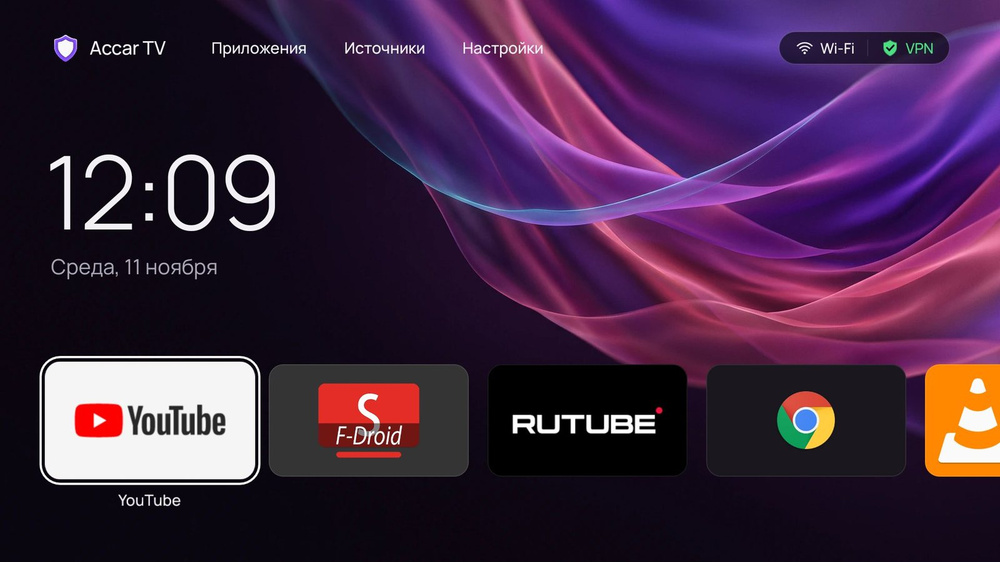
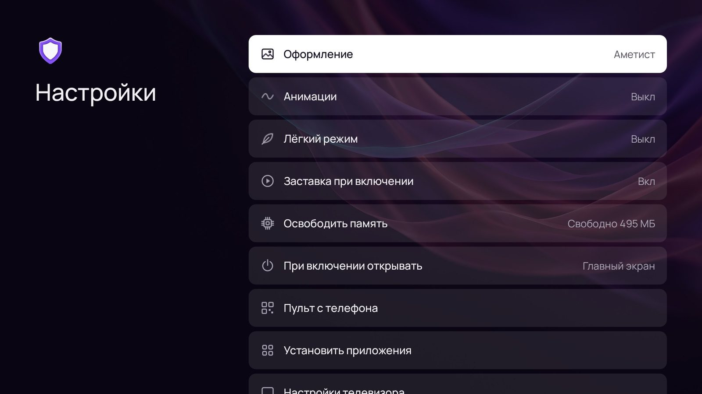
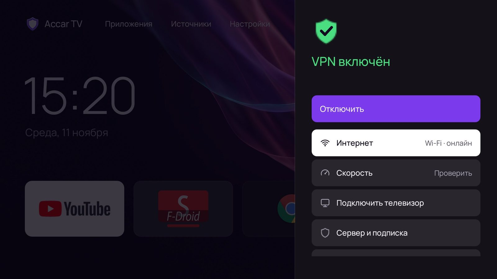
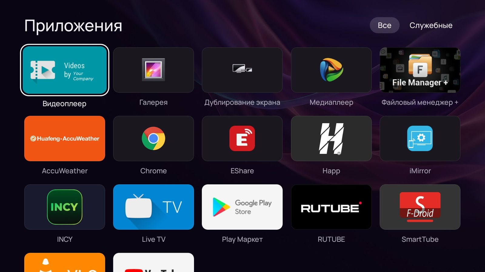
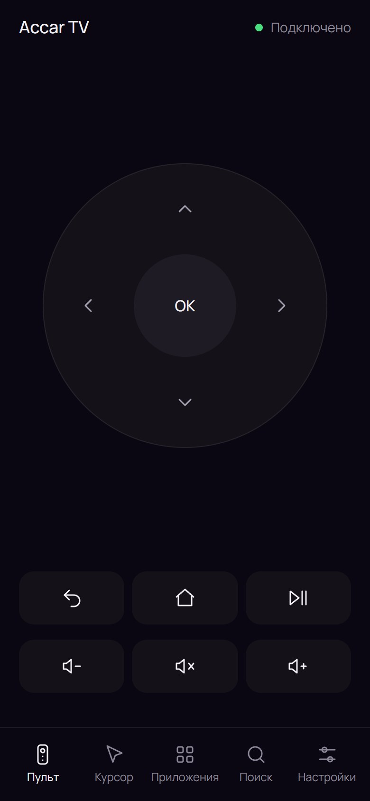
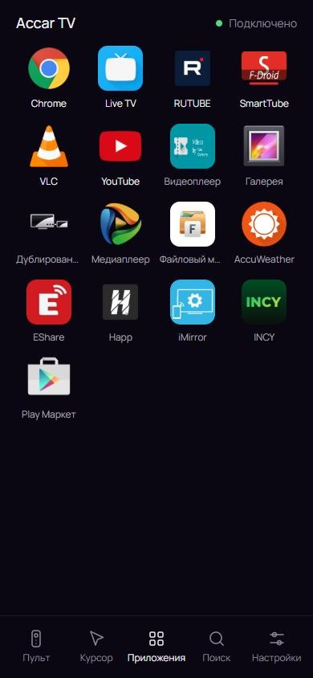

# Accar TV

Быстрый и простой главный экран для телевизоров и приставок на Android 5.0 и новее.

Accar TV — обычное приложение. Прошивка телевизора не меняется, родной экран остаётся на месте и возвращается в один шаг.

| Настройки | Подключение и скорость |
|---|---|
|  |  |

**Пульт с телефона** открывается по QR-коду с экрана телевизора, ставить ничего не нужно:

  
  &nbsp;&nbsp;
  

Ссылка на файл: `https://github.com/al0ha-c0de/accar-tv/raw/main/accar-tv.apk`

## Какой способ выбрать

| Способ | Что нужно | Скачивает ли телевизор |
|---|---|---|
| [С флешки](#2-с-флешки) | Флешка | Нет |
| [С телефона через Send Files to TV](#5-с-телефона-через-send-files-to-tv) | Телефон и Google Play на ТВ | Нет |
| [С компьютера по сети](#1-с-компьютера-по-сети) | Компьютер с Windows и раздел «Для разработчиков» на ТВ | Нет |
| [Downloader](#3-downloader) | Google Play на телевизоре | Да |
| [Браузер на телевизоре](#4-браузер-на-телевизоре) | Chrome или другой браузер | Да |

Самое простое — флешка или Send Files to TV: ничего настраивать не нужно. Если ни то, ни другое не подходит, ставьте с компьютера.

## 1. С компьютера по сети

Подходит не всем: некоторые производители (например, KRAFT на Android 7) прячут раздел «Для разработчиков» или закрывают отладку по сети. Тогда выбирайте флешку или Send Files to TV.

1. На телевизоре откройте «Об устройстве» и 7 раз нажмите на «Сборка». На Android 7 это «Настройки» → «Об устройстве», на Android 9 и новее «Настройки» → «Настройки устройства» → «Об устройстве». Должно появиться сообщение «Вы стали разработчиком».
2. В разделе «Для разработчиков» включите «Отладка по USB». Если там есть «Отладка по сети» или «Беспроводная отладка», включите и её. На многих приставках хватает одной «Отладки по USB»: отдельного пункта для сети там просто нет.
3. На компьютере скачайте [accar-tv-installer-windows.zip](https://github.com/al0ha-c0de/accar-tv/raw/main/accar-tv-installer-windows.zip), распакуйте и запустите `Install-Accar-TV.bat`.
4. Введите IP-адрес телевизора («Настройки» → «Сеть»). Если телевизор показывает код сопряжения, установщик спросит его.
5. На телевизоре разрешите отладку: «Всегда» → «ОК».

Установщик сам скачает официальные инструменты Google и Accar TV, поставит его и по вашему желанию сделает главным экраном.

Ещё он предложит отключить рекламу и сбор данных производителя (сейчас список знает телевизоры на платформе Zeasn, например KRAFT). Ничего не удаляется: сервисы только выключаются, а список сохраняется на телевизоре и на компьютере. Вернуть всё как было: запустите `Restore-TV.bat` из того же архива. Пока сервисы выключены, телевизор может не сообщать о новой прошивке от производителя. Обновления Accar TV приходят как обычно.

## 2. С флешки

1. На компьютере или телефоне скачайте [accar-tv.apk](accar-tv.apk) и скопируйте на флешку.
2. Разрешите на телевизоре установку из неизвестных источников (см. ниже).
3. Вставьте флешку, откройте файл в файловом менеджере и нажмите «Установить».

## 3. Downloader

1. Разрешите установку из неизвестных источников (см. ниже).
2. В Google Play на телевизоре установите **Downloader** (AFTVnews).
3. Введите ссылку на файл и нажмите «Установить».

## 4. Браузер на телевизоре

Откройте ссылку на файл в Chrome, затем откройте скачанный файл и нажмите «Установить».

## 5. С телефона через Send Files to TV

1. Установите **Send Files to TV** из Google Play и на телефон, и на телевизор.
2. На телефоне скачайте [accar-tv.apk](https://github.com/al0ha-c0de/accar-tv/raw/main/accar-tv.apk).
3. Откройте приложение на телевизоре и нажмите «Получить», на телефоне — «Отправить» и выберите файл.
4. На телевизоре откройте полученный файл и нажмите «Установить».

## Если файл не устанавливается

- **«Синтаксическая ошибка» или «Не удалось разобрать пакет».** Посмотрите версию Android: «Настройки» → «Об устройстве». Accar TV работает на Android 5.0 и новее. Если версия подходит, файл скачался не полностью: скачайте его заново.
- **«Установка заблокирована».** Разрешите неизвестные источники (ниже).
- **«Приложение не установлено».** Удалите старую версию Accar TV и поставьте снова.

## Неизвестные источники

Обычно: «Настройки» → «Безопасность и ограничения» → «Неизвестные источники». На новых моделях разрешение выдаётся отдельно приложению, которое ставит файл (Downloader, файловый менеджер, браузер).

## После установки

Нажмите «Домой» на пульте, выберите **Accar TV** и «Всегда».

Пульт с телефона: Accar TV → «Настройки» → «Пульт с телефона». Курсор включается в настройках телевизора: «Специальные возможности» → «Курсор Accar». Он нужен для браузера и приложений, где есть мышка, и работает на Android 7.0 и новее.

Ещё в «Настройках»:

- **Освободить память** — закрывает приложения, которые висят в фоне, и показывает, сколько памяти вернулось. Службы телевизора, клавиатуру, курсор и VPN не трогает.
- **При включении открывать** — выбранное приложение (например, YouTube или IPTV) открывается сразу после включения телевизора.

В панели подключения (справа вверху) есть **Скорость**: за 8 секунд показывает скорость интернета и пинг.

## Как вернуть прежний экран

Accar TV → «Настройки» → «Вернуть прежний экран» → «ОК». Приложение удалится, и телевизор вернётся к своему экрану.

Если при установке с компьютера вы отключали рекламу производителя, включите её обратно через `Restore-TV.bat`: удаление Accar TV её не возвращает.

## Обновления

Accar TV сам проверяет новую версию на GitHub раз в 12 часов. Когда она выходит, на вкладке «Настройки» появляется зелёная точка, а сверху пункт «Обновить Accar TV». Проверить вручную: «Настройки» → «Версия Accar TV».

## Где не заработает

- Samsung (Tizen), LG (webOS), Hisense VIDAA: это не Android, приложения для Android на них не ставятся.
- Android ниже 5.0.
- Google TV (Android 12 и новее): приложение ставится и открывается, но кнопка «Домой» может по-прежнему открывать экран Google.
